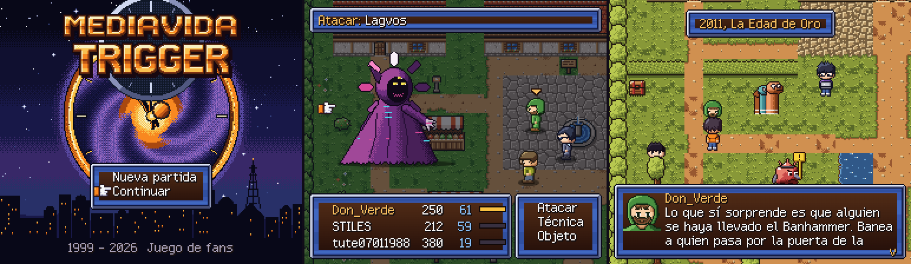
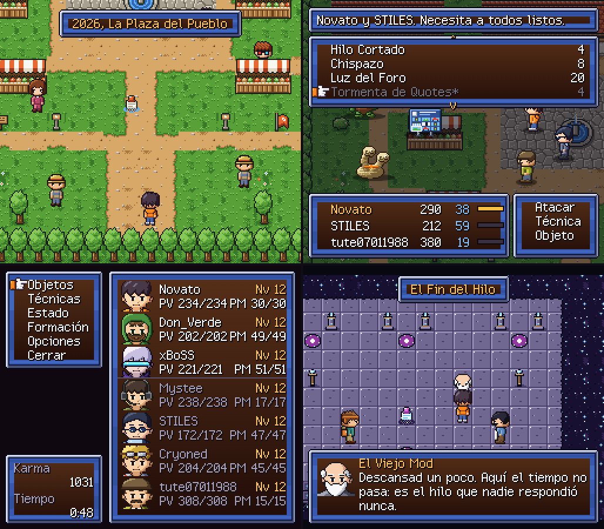

# Mediavida Trigger ⏳: el foro, en 16 bits.

> Un hilo necroposteado abre un portal. Toca salvar el foro a través del tiempo.

[](https://bun.sh)
[](https://www.typescriptlang.org)
[](https://vite.dev)
[](https://www.aseprite.org)
[](#aviso)

RPG de navegador al estilo de los clásicos de 16 bits, ambientado en [Mediavida](https://www.mediavida.com). Combate **ATB sobre el mapa**, técnicas dobles y triples, cuatro eras del foro y un grupo de foreros reales tratados con cariño. Todo el arte, el texto y la música son originales.



## Por qué

- **El foro como mundo.** La Plaza del Pueblo en 2026, la era de los clanes en 2005, la Edad de Oro del OFF-Topic en 2011 y un 2036 lleno de bots.
- **Combate de los de antes.** Barras ATB por Velocidad, modo Espera o Activo, elementos con debilidades y 41 técnicas, combos incluidos.
- **Hecho a mano y en código.** Cada sprite es una cuadrícula ASCII en TypeScript que Aseprite convierte en un `.aseprite` editable. La música se sintetiza con WebAudio.
- **Sin ROMs.** Chrono Trigger es la inspiración. Ningún asset sale de él.

## Jugar

Necesitas [Bun](https://bun.sh) 1.4 o posterior.

```bash
git clone https://github.com/rechedev9/mediavida-trigger.git
cd mediavida-trigger
bun install
bun run dev
```

Abre http://localhost:5199 en el navegador. La partida se guarda en el `localStorage` del navegador.

### Controles

| Acción                     | Teclas             |
| -------------------------- | ------------------ |
| Moverse                    | Flechas o WASD     |
| Confirmar, hablar          | Z, Enter o Espacio |
| Cancelar                   | X, Esc o Retroceso |
| Menú                       | C o Tab            |
| Correr, pasar texto rápido | Shift              |
| Huir del combate           | Mantener Shift     |

## La historia

Novato acaba de registrarse con el rango "Inocente". En la feria de la Plaza del Pueblo un hilo necroposteado se abre como un portal y lo lanza al pasado. En 2036 una IA llamada Lagvos ha llenado el foro de bots, y todo empezó con un bug de 2005.

| Era                                 | Jefe                | Se une               |
| ----------------------------------- | ------------------- | -------------------- |
| 2026, La Plaza del Pueblo           | -                   | STILES, tute07011988 |
| 2005, Media-Vida: Era de los Clanes | Gran Troll          | Mystee               |
| 2011, La Edad de Oro                | Banhammer (poseído) | Don_Verde, Cryoned   |
| El Fin del Hilo                     | -                   | -                    |
| 2036, El Foro Automático            | IA Suprema          | xBoSS                |
| Final                               | Lagvos              | -                    |



## Cómo está hecho

| Parte | Dónde                    | Notas                                                                                      |
| ----- | ------------------------ | ------------------------------------------------------------------------------------------ |
| Motor | `src/engine`             | Canvas a 256x224 con escalado entero, escenas apiladas, entrada y texto                    |
| Juego | `src/game`               | Campo, combate ATB, menús, diálogos, tienda, final                                         |
| Datos | `src/data`               | Grupo, técnicas, enemigos, objetos y los 8 mapas                                           |
| Audio | `src/audio`              | 14 pistas escritas como notas en TypeScript y sintetizadas con WebAudio                    |
| Arte  | `art/src`, `scripts/art` | Paletas y cuadrículas ASCII que `bun run art` lleva a Aseprite y exporta a `public/assets` |

El [contrato de assets](docs/asset-contract.md) fija tamaños, tags de animación y paletas que el motor espera.

## Desarrollo

| Tarea                          | Comando         |
| ------------------------------ | --------------- |
| Servidor de desarrollo         | `bun run dev`   |
| Build de producción en `dist/` | `bun run build` |
| Regenerar el arte con Aseprite | `bun run art`   |
| Tests                          | `bun test`      |
| Lint y tipos                   | `bun run lint`  |
| Formato                        | `bun run fmt`   |
| Código sin usar                | `bun run knip`  |

`bun run art` busca Aseprite en la ruta de Steam. Usa `ASEPRITE_PATH` para indicar otra.

## Más info

- [Diseño del juego](docs/design.md)
- [Contrato de assets](docs/asset-contract.md)
- [Investigación de usuarios y lore](docs/research.md)
- [Guía de tiles](art/TILES.md)

## Aviso

Juego de fans sin ánimo de lucro. No está afiliado a Mediavida ni a Square Enix. Los foreros que aparecen salen con su nick público y en tono de homenaje. Si eres uno de ellos y prefieres no salir, abre un issue y te quito.
